# Executive summary

A Portuguese retail bank asked us to find out whether machine learning can make its telephone campaigns for term deposits more efficient, and if so which approach it should adopt. Using 41,176 de-duplicated client contacts from the public UCI Bank Marketing dataset, we framed the task as **supervised binary classification**: before a call is made, estimate the probability that the client will subscribe.

We built a leakage-safe pipeline, tested each preprocessing decision experimentally, tuned three different models and combined the best two with voting and stacking, evaluating everything once on a held-out test set of 8,236 clients.

The main findings are:

* **Supervised classification is the right paradigm**: k-means clusters were barely related to subscription (Adjusted Rand Index ≤ 0.10).
* **`duration` must be excluded**: it is only known after the call and would inflate ROC-AUC from 0.79 to 0.95.
* **Preprocessing was decided by experiment**: 'unknown' kept as a category, class weights with a tuned threshold, and scaling were adopted; PCA, SMOTE and undersampling each reduced PR-AUC and were rejected.
* **Tree models beat the linear baseline**: test PR-AUC 0.482 (Random Forest) and 0.486 (Gradient Boosting) against 0.446 (Logistic Regression).
* **We recommend the soft-voting ensemble of the two tree models.** It had the best test PR-AUC (0.487), ROC-AUC (0.813), F1 (0.530) and MCC (0.467). Its gain over the cross-validated best model is small (+0.005 PR-AUC) but statistically reliable. Stacking was no better and six times slower.
* **Business impact**: calling the top-scored 20% of clients reaches 66% of subscribers, cutting calls per deposit from 8.9 to 2.7.

# Part A: Machine learning problem analysis

## A1. Business background

Term deposits are a stable, low-cost source of funding for retail banks. The client, a Portuguese bank, ran telephone campaigns between May 2008 and November 2010 (Moro, Cortez and Rita, 2014), through the financial crisis, when interest rates fell sharply. Each call uses paid agent time, and unwanted calls damage relationships, yet only 11.3% of contacts ended in a subscription.

## A2. Business objective

The bank wants to **reach as many future subscribers as possible while making fewer calls**. Put differently, it wants to lower the cost per acquired deposit by prioritising the clients most likely to say yes, and to stop calling clients with very low propensity. Success is therefore measured in business terms as the share of subscribers reached for a given call budget (for example, the top 20% of the call list).

## A3. Machine learning objective

Learn a function that maps the information available **before** a call (client profile, contact history and macroeconomic context) to the probability that the client subscribes. The output is used in two ways: as a **ranking** (who to call first) and, with a chosen threshold, as a **decision** (call or do not call). Because positives are rare and both uses matter, the primary metric is the area under the precision-recall curve (PR-AUC, computed as average precision), supported by ROC-AUC, F1, recall, precision, Matthews correlation coefficient and the cumulative-gains "capture at top 20%".

## A4. Dataset characteristics

We used `bank-additional-full.csv` from the UCI Machine Learning Repository, the richer version of the dataset that adds five macroeconomic indicators. It is real-world, publicly available and satisfies the brief comfortably:

| Property | Value |
|---|---|
| Observations | 41,188 (41,176 after removing 12 exact duplicates) |
| Attributes | 20 input features plus the target |
| Feature types | 10 categorical (nominal), 10 numeric |
| Target | `y`: subscribed a term deposit (yes/no) |
| Positive class | 4,640 of 41,188 (11.27%) |
| Missing values | no NaNs, but 'unknown' placeholders in six categorical columns |
| Time span | May 2008 to November 2010, rows in chronological order |

## A5. Feature descriptions

The features fall into four groups.

| Group | Feature | Type | Description |
|---|---|---|---|
| Client | `age` | numeric | Age in years |
| | `job` | nominal (12) | Occupation, e.g. admin., blue-collar, retired, student |
| | `marital` | nominal (4) | Married, single, divorced, unknown |
| | `education` | nominal (8) | basic.4y to university.degree, illiterate, unknown |
| | `default` | nominal (3) | Has credit in default |
| | `housing`, `loan` | nominal (3) | Has a housing / personal loan |
| Last contact | `contact` | nominal (2) | Cellular or telephone |
| | `month`, `day_of_week` | nominal | When the last contact took place |
| | `duration` | numeric | Call length in seconds (**known only after the call**) |
| Campaign history | `campaign` | numeric | Number of contacts in this campaign |
| | `pdays` | numeric | Days since last contact in a previous campaign (999 = never) |
| | `previous` | numeric | Contacts before this campaign |
| | `poutcome` | nominal (3) | Outcome of the previous campaign |
| Macroeconomic | `emp.var.rate`, `cons.price.idx`, `cons.conf.idx`, `euribor3m`, `nr.employed` | numeric | Employment variation, consumer prices and confidence, 3-month Euribor, number employed |

## A6. Target variable

The target `y` is binary (`yes` = subscribed). It is the outcome of the last call in the campaign, so it is a labelled, observed business outcome rather than a derived score.

## A7. Possible challenges

Five challenges were visible before any modelling and shaped the design:

1. **Target leakage.** `duration` is the strongest single predictor (Spearman ρ = 0.35 with `y`) but is only known once the call has ended, and a zero-second call is always a "no". A model that uses it cannot be deployed to decide whom to call. Section D quantifies the effect.
2. **Class imbalance** (about 1 positive in 9), which makes accuracy misleading and biases learners towards the majority class.
3. **Disguised missing values**: 'unknown' appears in 20.9% of `default` and 4.2% of `education`.
4. **Sentinel coding and skew**: `pdays` = 999 for 96% of rows, and `campaign` has skewness 4.8.
5. **Temporal drift**: the macro indicators move in steps over time and the subscription rate moves with them, so the relationship may not hold in a different economic climate.

## A8. Problem type: classification, regression or clustering?

The dataset is best suited to **classification**. The technical justification is:

* **The target is categorical and observed** for every row, the defining setting of supervised classification. Regression needs a continuous outcome (such as deposit amount), which is unavailable; regressing on 0/1 would give unbounded predictions and a loss unsuited to a Bernoulli outcome.
* **The decision is binary.** The bank decides to call or not to call, which maps directly onto a classifier with a threshold.
* **Clustering ignores the label**, and Part B shows that the natural clusters do not line up with subscription.
* **Probabilistic classifiers also give a ranking**, which serves the call-prioritisation use case without a separate model.

# Part B: Comparative analysis of learning approaches

## B1. Supervised and unsupervised learning compared

| Dimension | Supervised learning | Unsupervised learning |
|---|---|---|
| Learning mechanism | Minimises a loss between predictions and known labels, e.g. log-loss for classification; parameters are fitted to map inputs to outputs | Finds structure without labels by optimising an internal criterion, e.g. within-cluster variance (k-means), density, or reconstruction error (PCA) |
| Data required | Labelled examples (x, y); labels can be costly to obtain | Unlabelled examples x only; cheap and plentiful |
| Output | A predictive function for a defined target | Groups, components, densities or anomalies whose meaning must be interpreted |
| Evaluation | Direct and objective on held-out labels (PR-AUC, F1 and so on) | Indirect: internal indices (silhouette, inertia) or expert judgement; no ground truth |
| Scalability | Linear models and histogram-based boosting scale to millions of rows; kernel methods scale poorly (O(n²) to O(n³)) | k-means is roughly O(n·k·d) per iteration and scales well; hierarchical clustering is O(n²) memory; DBSCAN depends on indexing |
| Interpretability | Ranges from transparent (logistic coefficients, shallow trees) to opaque (large ensembles), with post-hoc tools such as permutation importance | Centroids and loadings can be described, but clusters often mix several factors and need careful naming |
| Advantages | Optimises exactly the business outcome; performance is measurable; supports thresholds and costs | No labelling cost; can reveal unknown segments; useful for exploration, compression and anomaly detection |
| Limitations | Needs representative labels; can learn label noise and bias; may overfit | No guarantee that the structure found is relevant to the business question; results depend on scaling, distance metric and k |
| Computational considerations | Training cost grows with model capacity and hyperparameter search; inference is usually cheap | Repeated restarts (k-means++) and choosing k add cost; distance calculations become less meaningful in high dimensions after one-hot encoding |

## B2. Empirical probe: does the data cluster by outcome?

To test the comparison rather than assert it, we fitted k-means (k = 2 to 8, ten restarts each) to 10,000 training clients after the same preprocessing used later, with the label hidden. We then measured agreement between clusters and the label using the Adjusted Rand Index (ARI), where 0 means no agreement beyond chance and 1 means perfect agreement.

| k | Silhouette | ARI vs label | Highest cluster subscription rate | Lowest |
|---|---|---|---|---|
| 2 | 0.181 | 0.062 | 20.0% | 5.7% |
| 3 | 0.186 | 0.104 | 64.5% | 5.6% |
| 4 | 0.113 | 0.043 | 64.5% | 4.0% |
| 6 | 0.125 | 0.035 | 64.5% | 3.9% |
| 8 | 0.136 | 0.024 | 64.8% | 4.3% |

Silhouettes below 0.2 indicate weak structure, and ARI never exceeds 0.10. One small cluster has a 64.5% subscription rate, but on inspection (k = 3) it is the 4% of clients who were contacted in a previous campaign, 92% of them successfully, a fact a supervised model learns directly. The other two clusters simply separate the high-interest-rate period (Euribor about 4.8%, 5.6% subscription) from the low-rate period (Euribor about 1.9%, 15.0% subscription). Clustering therefore produces segments that are partly useful for description but cannot rank individual clients by propensity.

## B3. Justification of the selected paradigm

Supervised classification is the most appropriate paradigm because (i) a reliable label exists for every row; (ii) the business question is predictive and individual (who should we call?), not descriptive; (iii) supervised performance can be measured objectively on held-out data, which the client needs as evidence; and (iv) the probe above shows that unsupervised structure is only weakly related to the outcome. Unsupervised methods still have a supporting role: PCA was tested as a preprocessing step (Part D) and clustering could be used later to design messaging for segments.

# Part C: Exploratory data analysis and data-quality investigation

All statistics in this section are computed on the raw 41,188 rows so that the data-quality issues are reported as received from the client.

## C1. Descriptive statistics and skewness

| Feature | Mean | Std | Min | Median | Max | Skew | Kurtosis |
|---|---|---|---|---|---|---|---|
| age | 40.0 | 10.4 | 17 | 38 | 98 | 0.79 | 0.79 |
| duration | 258.3 | 259.3 | 0 | 180 | 4,918 | 3.26 | 20.25 |
| campaign | 2.57 | 2.77 | 1 | 2 | 56 | 4.76 | 36.98 |
| pdays | 962.5 | 186.9 | 0 | 999 | 999 | -4.92 | 22.23 |
| previous | 0.17 | 0.49 | 0 | 0 | 7 | 3.83 | 20.11 |
| emp.var.rate | 0.08 | 1.57 | -3.4 | 1.1 | 1.4 | -0.72 | -1.06 |
| cons.price.idx | 93.58 | 0.58 | 92.20 | 93.75 | 94.77 | -0.23 | -0.83 |
| cons.conf.idx | -40.50 | 4.63 | -50.8 | -41.8 | -26.9 | 0.30 | -0.36 |
| euribor3m | 3.62 | 1.73 | 0.63 | 4.86 | 5.05 | -0.71 | -1.41 |
| nr.employed | 5,167 | 72.3 | 4,964 | 5,191 | 5,228 | -1.04 | 0.00 |

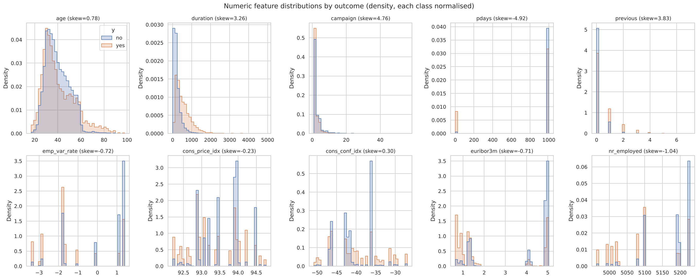

**Impact on ML.** `campaign`, `previous` and `duration` are strongly right-skewed (kurtosis above 20): for linear and distance-based models a few extreme values dominate the fit, while trees, which split on rank order, are unaffected. The macro features take only 10 to 26 distinct values (monthly or quarterly), so they act more like period identifiers than continuous measurements.

## C2. Correlation analysis

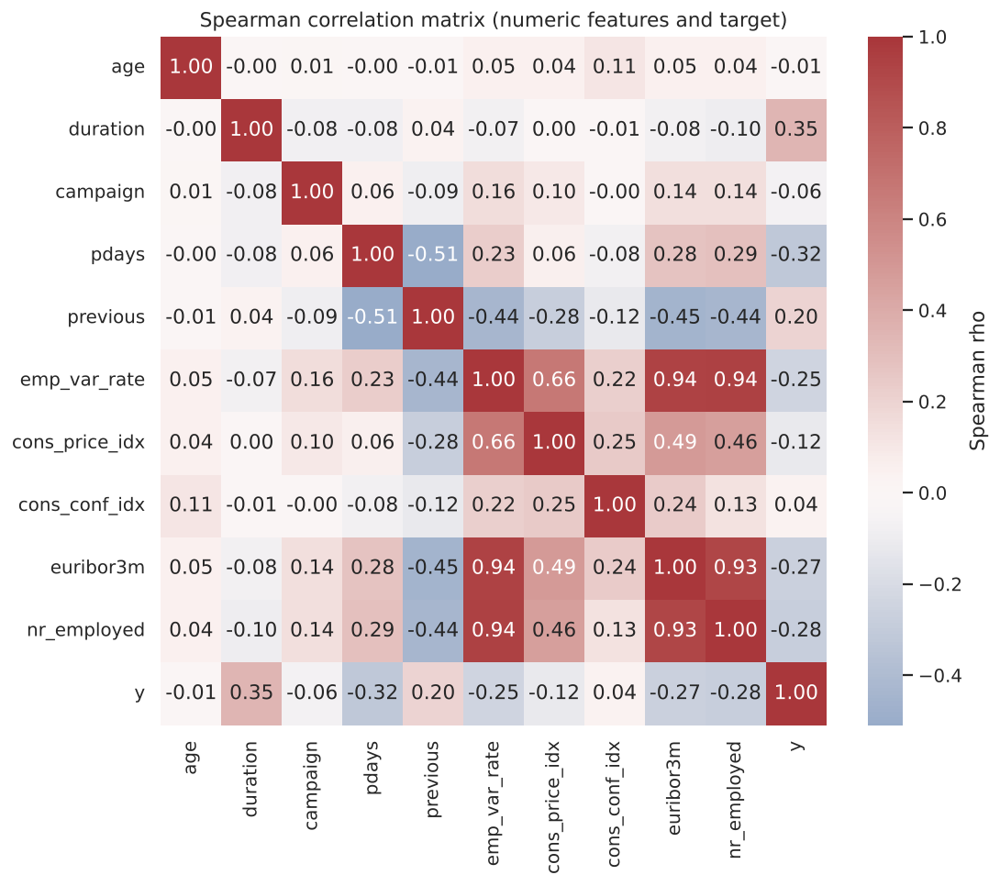

Spearman correlation was used because several variables are skewed or ordinal-like. Three findings matter:

* **Severe multicollinearity among macro indicators**: `emp.var.rate`, `euribor3m` and `nr.employed` are correlated at ρ = 0.93 to 0.94. In a linear model this inflates coefficient variance and makes individual coefficients uninterpretable, though predictive accuracy is barely affected.
* **The strongest associations with `y`** are `duration` (0.35, leaky), `pdays` (-0.33), `nr.employed` (-0.28), `euribor3m` (-0.27), `emp.var.rate` (-0.25) and `previous` (0.20). Subscriptions are more likely when interest rates and employment are low, which is consistent with savers locking in rates during the crisis.
* `age` has no monotonic relationship with `y` (ρ = -0.01), yet under-25s and over-60s subscribe more: a U-shape that trees capture and a linear model cannot.

For categorical features we computed Cramér's V with the target: `poutcome` (0.32), `month` (0.27), `job` (0.15), `contact` (0.15) and `default` (0.10) are the most informative, while `housing` (0.01) and `loan` (0.005) are close to independent of the outcome.

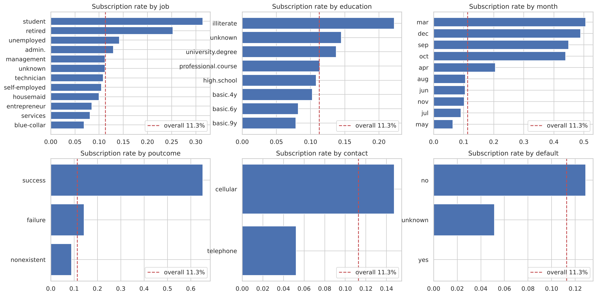

## C3. Missing values

There are no NaN values, but six categorical columns use the string 'unknown' as a placeholder:

| Column | 'unknown' rows | % |
|---|---|---|
| default | 8,597 | 20.87 |
| education | 1,731 | 4.20 |
| housing | 990 | 2.40 |
| loan | 990 | 2.40 |
| job | 330 | 0.80 |
| marital | 80 | 0.19 |

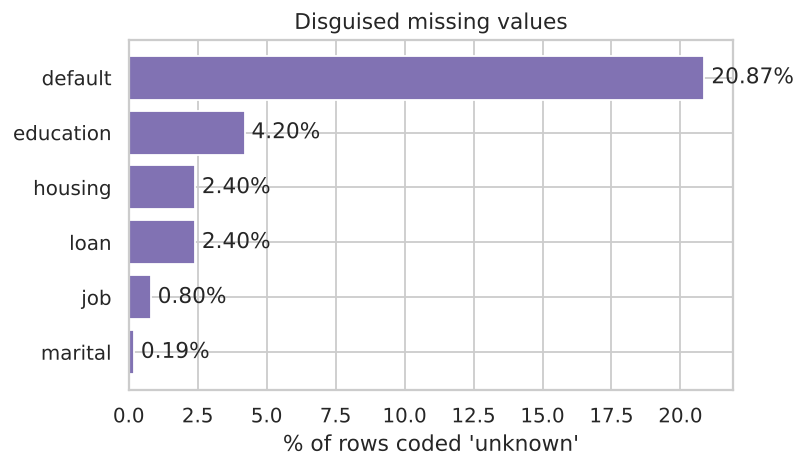

`housing` and `loan` are 'unknown' on exactly the same 990 rows, which points to a single system gap rather than client refusal. In contrast, 'unknown' in `default` is informative: clients with unknown default status subscribe at 5.2%, against 12.9% for "no". The values are therefore **not missing completely at random**. **Impact:** deleting these rows would discard 26% of the data and bias the sample, and naive imputation could erase a real signal.

## C4. Duplicate analysis

There are 12 exact duplicate rows (24 rows involved). Removing the label and checking again gives the same 12, so no identical clients have conflicting labels. **Impact:** duplicates are few, but if one copy lands in training and the other in test they inflate test scores slightly and give those clients double weight. They are removed.

## C5. Outlier analysis

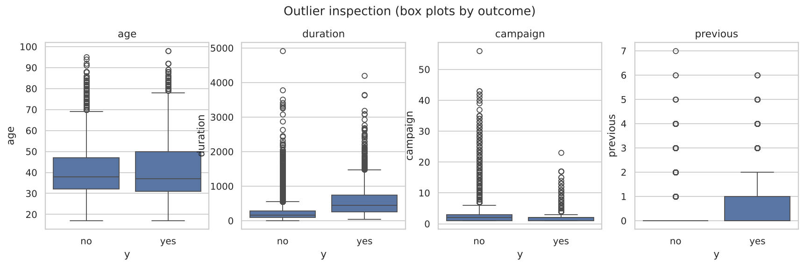

Using Tukey fences (1.5 × IQR), 7.2% of `duration`, 5.8% of `campaign`, 1.1% of `age` and 1.1% of `cons.conf.idx` values are outliers; `previous` flags 13.7% only because its IQR is zero. On inspection these are **genuine extreme values, not errors**: ages of 98 exist, and some clients were genuinely called 56 times. Deleting them would remove real behaviour (for example, older clients have a much higher subscription rate). **Impact:** extremes pull linear-model coefficients and inflate scaling statistics; trees are robust to them. We therefore transform rather than delete (Part D).

## C6. Class imbalance

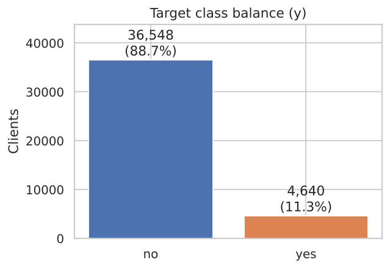

Only 11.27% of contacts are positive (ratio about 7.9 : 1). **Impact:** a model that always predicts "no" is 88.7% accurate and useless, so accuracy is not reported as a headline metric. Learners that minimise average loss under-weight the minority class, which shows up as low recall at the default 0.5 threshold. ROC-AUC can look optimistic under imbalance because it rewards correct ordering of the many easy negatives, which is why PR-AUC is our primary metric (Saito and Rehmsmeier, 2015).

## C7. Noise and inconsistencies

Several consistency rules were checked:

* **`pdays` against `previous`**: 4,110 clients have `pdays` = 999 ("never contacted") yet `previous` > 0, so the two columns encode different notions of "contacted before". We keep both rather than "correct" either.
* **Rare levels**: `default` = 'yes' occurs only 3 times and `education` = 'illiterate' 18 times. One-hot columns with so few examples add parameters without reliable estimates.
* **Zero-length calls**: 4 calls have `duration` = 0, all "no", confirming that `duration` is determined by the outcome.
* **Label noise**: a client's decision depends on factors not recorded here, and the class overlap visible in every histogram means no model can separate the classes cleanly.

## C8. Temporal drift

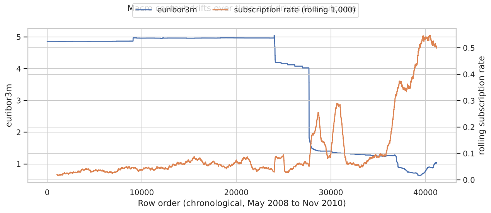

The rows are ordered in time. When Euribor collapsed in late 2008 and again from 2009, the rolling subscription rate rose from about 5% to over 40%. The macro features therefore carry much of the predictive signal, but they describe the period rather than the individual client. **Impact:** a model trained on 2008 to 2010 will be well calibrated only if future conditions resemble that period. This is a key limitation that we return to in the recommendation.

# Part D: Data preparation and feature engineering

## D1. Pipeline design principle

Preprocessing was split into two stages to prevent **data leakage**:

1. **Stateless steps** that learn nothing from the data (de-duplication, dropping `duration`, deterministic transforms) are applied once; their output is the cleaned dataset `bank_marketing_cleaned.csv` (41,176 × 20).
2. **Fitted steps** (imputation, scaling, encoding, feature selection, PCA, resampling) sit inside one `imblearn` `Pipeline`, refitted on each training fold, so validation and test data never influence a fitted parameter.

The data were split 80/20 with stratification on `y` (32,940 training and 8,236 test rows, both with 11.27% positives) and a fixed seed. The test set was used exactly once, in Part H.

```
clean_and_engineer (stateless)
   └─► ColumnTransformer
         ├─ numeric:  [correlation filter, LR only] → StandardScaler
         └─ nominal:  ['unknown' kept as level] → OneHotEncoder(min_frequency=30)
   └─► [PCA: tested, rejected] → [SMOTE: tested, rejected] → classifier(class_weight="balanced")
```

## D2. Controlled experiments

Each decision below was tested **one factor at a time**, with everything else fixed, using 5-fold stratified cross-validation on the training set with a linear model (Logistic Regression, LR) and a non-linear model (Histogram Gradient Boosting, HGB). The table reports mean scores; PR-AUC standard deviations across folds were between 0.009 and 0.018, so differences below about 0.01 should be treated as noise.

| Experiment | Model | Variant | ROC-AUC | PR-AUC | F1 @0.5 | Recall @0.5 |
|---|---|---|---|---|---|---|
| Unknown handling | LR | keep as category | 0.790 | 0.444 | 0.449 | 0.628 |
| | LR | mode imputation | 0.790 | 0.444 | 0.448 | 0.626 |
| | HGB | keep as category | 0.791 | 0.460 | 0.465 | 0.614 |
| | HGB | mode imputation | 0.791 | 0.461 | 0.464 | 0.615 |
| Imbalance | LR | none | 0.789 | 0.449 | 0.344 | 0.232 |
| | LR | class weights | 0.790 | 0.444 | 0.449 | 0.628 |
| | LR | SMOTE | 0.787 | 0.440 | 0.439 | 0.627 |
| | LR | random undersampling | 0.788 | 0.442 | 0.442 | 0.628 |
| | HGB | none | 0.794 | 0.462 | 0.359 | 0.248 |
| | HGB | class weights | 0.791 | 0.460 | 0.465 | 0.614 |
| | HGB | SMOTE | 0.790 | 0.449 | 0.404 | 0.313 |
| | HGB | random undersampling | 0.783 | 0.431 | 0.432 | 0.633 |
| Scaling | LR | standard scaling | 0.790 | 0.444 | 0.449 | 0.628 |
| | LR | no scaling | 0.787 | 0.427 | 0.439 | 0.632 |
| Feature selection | LR | correlation filter | 0.790 | 0.444 | 0.449 | 0.628 |
| | LR | all features | 0.790 | 0.446 | 0.450 | 0.623 |
| | HGB | correlation filter | 0.791 | 0.460 | 0.465 | 0.614 |
| | HGB | all features | 0.800 | 0.466 | 0.473 | 0.623 |
| PCA | LR | none | 0.790 | 0.444 | 0.449 | 0.628 |
| | LR | PCA (95% variance) | 0.787 | 0.428 | 0.429 | 0.630 |
| | HGB | none | 0.791 | 0.460 | 0.465 | 0.614 |
| | HGB | PCA (95% variance) | 0.787 | 0.439 | 0.458 | 0.613 |

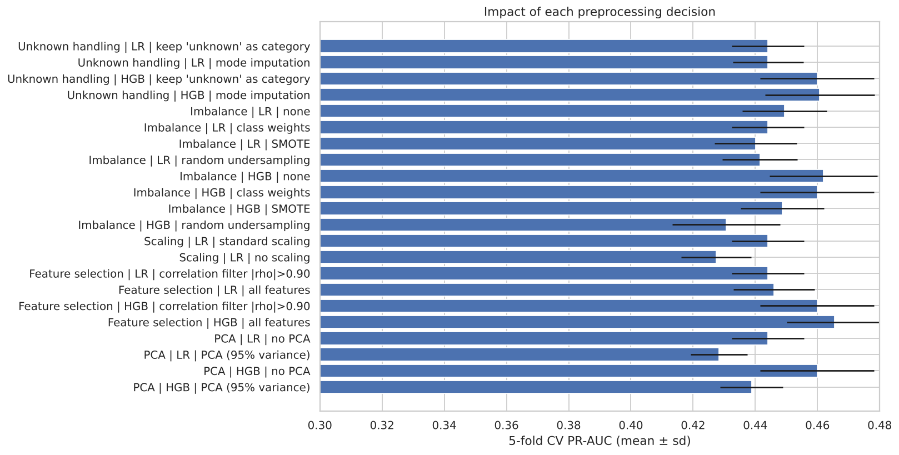

## D3. Missing-value handling

**Why required.** Six columns contain the placeholder 'unknown'; learners cannot process it meaningfully unless we decide what it means.

**Theory.** Rubin (1976) distinguishes data missing completely at random (MCAR), at random (MAR) and not at random (MNAR). Mode imputation is defensible under MCAR, but under MNAR missingness is itself informative, and Section C3 showed 'unknown' `default` has a much lower subscription rate.

**Choice.** Keep 'unknown' as its own category, which turns missingness into a feature, rather than impute the mode.

**Impact.** No measurable difference (PR-AUC 0.444 vs 0.444 for LR; 0.460 vs 0.461 for HGB), so we prefer the option that keeps information. The three `default` = 'yes' rows were merged into 'unknown', since a level with three examples cannot be estimated.

**Disadvantages.** An 'unknown' level is only meaningful if future data are 'unknown' for the same reasons. If the bank fixes the system gap that caused the `housing`/`loan` unknowns, that level will disappear and its learned effect will be wasted.

## D4. Duplicate removal

**Why and theory.** Exact duplicates give some observations double weight in the loss and, across a train/test split, let the model be tested on rows it has memorised, which inflates scores.

**Impact and disadvantages.** Removing 12 rows (0.03%) has a negligible effect on performance, but it makes the evaluation cleaner. The only risk is removing two genuinely different clients who happen to share all 21 values, which is very unlikely with this many attributes.

## D5. Encoding

**Why required.** All ten categorical features are nominal (no natural order, apart from loosely ordered education levels), and every model here needs numeric input.

**Theory.** One-hot encoding creates one indicator per level and imposes no false ordering, whereas label encoding would tell a linear model that "services" lies between "admin." and "student". Ordinal encoding of education was rejected because 'unknown' has no place in the order and the subscription rate is not monotonic in education.

**Implementation.** `OneHotEncoder(handle_unknown="infrequent_if_exist", min_frequency=30)` groups levels with fewer than 30 training rows (such as 'illiterate') into a shared "infrequent" column and maps levels that never appeared in training to it at prediction time, so the pipeline cannot fail on a new category. The result has 59 encoded features.

**Disadvantages.** One-hot encoding increases dimensionality and sparsity and makes distance-based methods (such as k-means in Part B) less effective. Grouping rare levels loses the specific signal of very small groups.

## D6. Feature scaling

**Why required.** Features range from about 0.6 (`euribor3m`) to 5,228 (`nr.employed`); a regularised model penalises unscaled coefficients unevenly, and solvers converge slowly on badly conditioned data.

**Theory.** Standardisation (z = (x − μ) / σ, fitted on training folds) gives zero mean and unit variance. Trees are invariant to it; it is kept in all pipelines for consistency.

**Impact.** Without scaling, LR's PR-AUC fell from 0.444 to 0.427 and training took 17 seconds instead of 1 because the solver needed many more iterations.

**Disadvantages.** Standardisation uses the mean and standard deviation, which are sensitive to outliers. This is one reason `campaign` is log-transformed first. A `RobustScaler` would be an alternative.

## D7. Feature engineering

Three features were engineered, each motivated by the EDA:

* **`prev_contacted` = 1 if `pdays` ≠ 999.** The sentinel 999 is not a real number of days. Left as is, a linear model reads it as "a very long time ago", which is meaningless, and it dominates the scale. A binary flag keeps the useful information, and `pdays` itself is dropped. This flag later became the second most important feature (Part H).
* **`campaign_log` = log(1 + `campaign`).** This reduces skewness from 4.8 to about 1.4 and limits the influence of extreme call counts, with no data removed.
* **`default` collapsed to two levels** (no vs unknown/yes), as described in D3.

**Disadvantages.** Log-scale coefficients are harder to explain, and the flag discards exact recency for the 4% of previously contacted clients.

`duration` was **removed** as a leakage control, not engineered. The benchmark below shows why:

| Model (5-fold CV, training set) | ROC-AUC | PR-AUC | F1 |
|---|---|---|---|
| HGB without `duration` (deployable) | 0.791 | 0.460 | 0.465 |
| HGB with `duration` (leaky) | 0.945 | 0.651 | 0.601 |

Including `duration` would raise ROC-AUC by over 0.15 and yield an apparently excellent model that cannot be used before a call (Kaufman et al., 2012).

## D8. Feature selection

**Why.** Highly correlated inputs add little information, increase variance for linear models and make coefficients unstable.

**Theory and implementation.** A custom `CorrelationFilter` is fitted on the training fold. It scans numeric features in order and drops any whose absolute Spearman correlation with an already kept feature exceeds 0.90. On the training data it removed `euribor3m` and `nr.employed`, keeping `emp.var.rate` as the representative of the employment and rate cycle. Mutual information (computed in the notebook) was used as a filter-style relevance check: the five macro features and `prev_contacted` rank highest, while `housing`, `loan` and `day_of_week` carry little information, consistent with the Cramér's V results.

**Impact and decision.** For LR the filter did not change performance (PR-AUC 0.444 vs 0.446) but makes coefficients stable, so it is kept for LR. For HGB it was harmful (ROC-AUC 0.800 to 0.791, PR-AUC 0.466 to 0.460): trees do not suffer from collinearity and can exploit small differences between the macro series, which change at different times. The filter is therefore **applied to Logistic Regression only**, a deliberate per-algorithm choice.

**Disadvantages.** Correlation filtering is univariate and greedy: which feature of a correlated pair is kept depends on column order, and it ignores interactions.

## D9. PCA

**Why considered.** After one-hot encoding there are 59 features, several of them collinear, and PCA could compress them into uncorrelated components.

**Theory.** PCA projects the standardised data onto the orthogonal directions of maximum variance. 27 components retain 95% of the variance.

**Impact and decision.** PCA reduced PR-AUC for both models (LR 0.444 to 0.428; HGB 0.460 to 0.439) and slowed HGB nearly fourfold. Being unsupervised, it keeps directions of maximum *variance*, not maximum *predictive* value, discarding rare but informative signals such as `poutcome` = success, and each component mixes many features, destroying interpretability. **PCA was not adopted.**

## D10. SMOTE and sampling methods

**Why considered.** With 11% positives, models trained on raw data have low recall at the default threshold (0.23 for LR, 0.25 for HGB).

**Theory.** Three remedies were compared:

* **Class weights** (cost-sensitive learning) multiply the loss of each minority example by about 4.4 (n / (2 · n_pos)), so the model pays more attention to subscribers without changing the data.
* **SMOTE** (Chawla et al., 2002) creates synthetic minority examples by interpolating between a minority point and one of its k nearest minority neighbours.
* **Random undersampling** discards majority examples until the classes balance.

All resampling was placed inside the pipeline, so synthetic points were only ever created from training folds. Resampling before the split, a common error, would leak information about validation points into the training data.

**Impact.** **None of the remedies improves ranking**: the unweighted models have the highest PR-AUC (LR 0.449, HGB 0.462). What they change is the probability scale, and hence recall at 0.5: class weights raise LR's recall from 0.23 to 0.63 and F1 from 0.34 to 0.45. SMOTE was worse than class weights on every metric for HGB (PR-AUC 0.449 vs 0.460) and three times slower; interpolating one-hot points creates unrealistic clients with fractional job or month values, and overlapping classes leave SMOTE little room to help (Elor and Averbuch-Elor, 2022). Undersampling discarded about 87% of negatives and lost accuracy.

**Decision.** Use **class weights** for all models and set the threshold explicitly on out-of-fold predictions (Part H): this keeps all real data, adds no synthetic noise and costs nothing extra.

**Disadvantages.** Like any reweighting or resampling, class weights distort predicted probabilities upwards (van den Goorbergh et al., 2022). Scores are fine for ranking but should not be read as literal probabilities without recalibration, which is reflected in the higher Brier scores of the weighted models in Part H.

# Part E: Development of three base models

## E1. Selection of models

The task is classification, so three classifiers were chosen to represent three different ways of learning, so that their errors are not all alike and the later ensemble has something to combine:

1. **Logistic Regression**: a linear, parametric model.
2. **Random Forest**: bagging of deep, decorrelated decision trees.
3. **Histogram Gradient Boosting**: boosting of shallow trees fitted sequentially to residual errors.

All three share the same preparation and class weights (only LR uses the correlation filter, D8), so differences come from the algorithms.

**Hyperparameter tuning.** Each model was tuned with `RandomizedSearchCV` (3-fold stratified CV on the training set, optimising PR-AUC). Random search covers wide continuous ranges more efficiently than grid search (Bergstra and Bengio, 2012). Tuned models were re-scored with 5-fold out-of-fold (OOF) predictions, giving every training row one prediction from a model that never saw it.

| Model | Search space | Best setting | Search time |
|---|---|---|---|
| Logistic Regression (12 draws) | C from 10⁻³ to 10² (log-uniform), L2 penalty | C = 0.075 | 4 s |
| Random Forest (12 draws, 300 trees) | max_depth {6 … 16, None}; min_samples_leaf 5–60; max_features {sqrt, 0.3, 0.5} | depth 12, leaf 19, sqrt | 97 s |
| Histogram Gradient Boosting (20 draws) | learning rate 0.02–0.2; max_leaf_nodes 8–48; min_samples_leaf 20–200; L2 10⁻³–10; iterations {200, 400, 600} with early stopping | lr 0.136, 9 leaves, leaf 40, L2 7.6 | 23 s |

## E2. Model 1: Logistic Regression

**Algorithm principles.** Logistic Regression models the log-odds of subscription as a linear combination of the features, log(p / (1 − p)) = β₀ + βᵀx, and passes it through the sigmoid function to obtain a probability. The coefficients are estimated by minimising the (class-weighted) log-loss plus an L2 penalty λ‖β‖², where C = 1/λ. The low tuned value C = 0.075 means fairly strong regularisation, which suits a model with 57 one-hot and numeric inputs, some of them rare.

**Assumptions.** Log-odds linear in the inputs; independent observations; little multicollinearity (hence the filter); comparable feature scales (hence standardisation).

**Strengths.** Fast, stable and transparent: each coefficient is an odds ratio the marketing team can understand. It needs little tuning and is hard to overfit.

**Weaknesses.** It cannot represent non-linear effects or interactions, such as the U-shaped age effect, without hand-engineering, and is sensitive to outliers and correlated inputs.

**Computational complexity.** Training with L-BFGS costs O(n · d) per iteration for n rows and d features, with tens to hundreds of iterations. Prediction costs O(d) per client. Here a full fit took under one second.

**Suitability.** A strong, interpretable baseline, suited to regulated settings; limited by its linear boundary.

## E3. Model 2: Random Forest

**Algorithm principles.** A Random Forest (Breiman, 2001) trains T decision trees, each on a bootstrap sample of the rows, and at each split considers only a random subset of features (here √d). Each tree is a high-variance, low-bias learner; averaging many decorrelated trees reduces variance without increasing bias. The predicted probability is the average of the trees' leaf class proportions. With `class_weight="balanced_subsample"`, weights are recomputed on each bootstrap sample.

**Assumptions.** Very few: no distributional or linearity assumptions; it assumes representative training data and imperfectly correlated tree errors.

**Strengths.** Captures non-linearity and interactions automatically, is robust to outliers and irrelevant inputs, does not overfit as trees are added, and parallelises across trees.

**Weaknesses.** Far less interpretable than a linear model, large in memory, slower to predict, and its probabilities are compressed towards the middle. Impurity-based importance is biased, so we used permutation importance instead.

**Computational complexity.** Training is roughly O(T · m · n log n), where m is the number of features tried per split; prediction is O(T · depth) per client. A full fit took about 2.3 seconds on four cores, and the tuning search was the most expensive step in the project (97 seconds).

**Suitability.** Well suited to mixed tabular data with interactions and noisy classes; the tuned depth limit (12) and leaf size (19) reflect the label noise.

## E4. Model 3: Histogram Gradient Boosting

**Algorithm principles.** Gradient boosting (Friedman, 2001) builds an additive model F(x) = Σ η · fₜ(x) of shallow trees. Each new tree fₜ is fitted to the negative gradient of the log-loss with respect to the current prediction, so it focuses on the clients the ensemble currently gets most wrong, and the learning rate η shrinks each step. The histogram variant, popularised by LightGBM (Ke et al., 2017), first bins each feature into at most 255 quantile bins, so split finding scans bins rather than sorted values. Early stopping on a 10% internal validation split stops adding trees once the loss stops improving.

**Assumptions.** No distributional assumptions; the signal must be approximable by a sum of small trees, with learning rate, tree size and iterations tuned to avoid fitting noise.

**Strengths.** Usually the most accurate family on tabular data; models interactions, handles skewed features natively, is very fast thanks to binning and has strong built-in regularisation (shrinkage, leaf size, L2, early stopping).

**Weaknesses.** Sensitive to hyperparameters, sequential to train, and a black box needing post-hoc explanation.

**Computational complexity.** Binning costs O(n · d) once; each boosting iteration then costs about O(n · d) to build histograms plus O(bins · d · leaves) to find splits, multiplied by the number of iterations T. Prediction is O(T · depth). A full fit took 0.7 seconds, the fastest of the three models after Logistic Regression.

**Suitability.** Highly suitable for medium-sized, mixed, non-linear data. Tuning chose small trees (9 leaves) and strong L2 regularisation, again indicating a noisy target where simple interactions suffice.

## E5. Cross-validated comparison of the base models

| Model (5-fold OOF, training set) | ROC-AUC | PR-AUC | F1* | Recall* | Precision* | Capture @ top 20% |
|---|---|---|---|---|---|---|
| Random Forest | 0.799 | **0.463** | **0.500** | 0.572 | 0.445 | 63.3% |
| Histogram Gradient Boosting | 0.798 | 0.462 | 0.498 | 0.568 | 0.443 | **63.6%** |
| Logistic Regression | 0.790 | 0.443 | 0.482 | 0.534 | 0.438 | 62.5% |

\* at each model's F1-maximising threshold, chosen on the same out-of-fold predictions.

The two tree ensembles are effectively tied and both clearly ahead of Logistic Regression, by about 0.02 PR-AUC and 0.009 ROC-AUC. The gap is consistent with the non-linear effects found in the EDA.

# Part F: Ensemble learning

## F1. Selection of the two models

The two models with the highest out-of-fold PR-AUC, **Random Forest** (0.463) and **Histogram Gradient Boosting** (0.462), were selected. The ranking was made on training-set cross-validation only, so the choice was not influenced by the test set.

**Why these two.** Besides being the most accurate, they reduce error in complementary ways: Random Forest *reduces variance* by averaging deep independent trees, while boosting *reduces bias* by adding shallow trees that correct remaining errors. Their out-of-fold scores correlate at 0.93, high but below 1.0, so averaging can still cancel some independent errors.

**Why Logistic Regression was excluded.** (i) It was clearly weakest (PR-AUC 0.443), and a weaker member pulls an average towards its errors. (ii) Its errors are systematic (no U-shaped age effect, no interactions), adding *bias* that averaging cannot remove. (iii) Its scores correlated at 0.88 to 0.91 with the trees', offering little diversity. (iv) Its interpretability is lost inside an ensemble. It remains useful as a benchmark and as the stacking meta-learner.

## F2. Ensemble methods

**Soft voting.** The ensemble's probability is the unweighted mean of the two members' probabilities, p = ½ (p_RF + p_HGB). Soft voting was preferred to hard (majority) voting because, with only two members, hard voting cannot break ties, and because averaging probabilities keeps the ranking information that the business use relies on. Equal weights were used because the members performed almost identically; fitting weights would add a parameter with little to gain and some risk of overfitting.

**Stacking.** Stacking (Wolpert, 1992) learns the combination: a class-weighted Logistic Regression meta-learner is trained on the members' 5-fold out-of-fold probabilities. Out-of-fold inputs are essential; otherwise the meta-learner learns to trust over-confident in-sample scores. The fitted meta-learner gave weight 3.24 to Random Forest and 1.84 to gradient boosting on the log-odds scale. Since RF's scores are more compressed, this mostly rescales them, and the combination is close to a simple average.

## F3. Expected benefits

Averaging M models with error variance σ² and pairwise correlation ρ gives ensemble variance ρσ² + (1 − ρ)σ²/M. With two members and ρ ≈ 0.93 the reduction is real but small, so we expected (i) a **modest gain in ranking quality**, (ii) **more stable predictions** across samples, because one model's idiosyncratic errors are diluted, and (iii) **robustness to model choice**: if one member degrades on future data, the other limits the damage. The cost is roughly the sum of the members' training and prediction time, plus five extra fits per member for stacking, and further loss of interpretability.

The OOF results confirmed a small improvement: soft voting reached PR-AUC 0.464 and stacking 0.466, against 0.463 for the best single model.

# Part H: Model evaluation and recommendation

## H1. Evaluation protocol and metrics

Every model was refitted on the full training set and evaluated **once** on the test set (8,236 rows, 928 subscribers). Thresholds were fixed beforehand at the F1-maximising point of the out-of-fold predictions. Metrics:

* **PR-AUC** (primary): the average precision across all recall levels. Its baseline is the positive rate (0.113), not 0.5, so it is sensitive to performance on the rare class.
* **ROC-AUC**: the probability that a random subscriber is scored above a random non-subscriber.
* **Precision, recall, F1** and **Matthews correlation coefficient (MCC)** at the chosen threshold, and **balanced accuracy**. MCC uses all four cells of the confusion matrix and is robust to imbalance.
* **Brier score**: mean squared error of the probabilities, a measure of calibration.
* **Capture at top 20%**: the share of all subscribers reached by calling the 20% of clients with the highest scores, the metric closest to the business objective.

Uncertainty was estimated with 1,000 bootstrap resamples (Efron and Tibshirani, 1993), and model differences with a **paired** bootstrap on the same resampled clients, which is far more sensitive than comparing separate intervals.

## H2. Results

| Test set | ROC-AUC | PR-AUC | Threshold | Precision | Recall | F1 | MCC | Brier | Capture @20% | Fit time |
|---|---|---|---|---|---|---|---|---|---|---|
| Model 1: Logistic Regression | 0.800 | 0.446 | 0.67 | 0.456 | 0.551 | 0.499 | 0.431 | 0.163 | 64.3% | 0.7 s |
| Model 2: Random Forest | 0.811 | 0.482 | 0.64 | 0.467 | **0.602** | 0.526 | 0.462 | **0.146** | 65.7% | 2.3 s |
| Model 3: Hist. Gradient Boosting | 0.813 | 0.486 | 0.65 | 0.464 | **0.603** | 0.525 | 0.460 | 0.155 | **66.3%** | 0.7 s |
| **Ensemble: Soft Voting (RF + HGB)** | **0.813** | **0.487** | 0.67 | **0.480** | 0.593 | **0.530** | **0.467** | 0.150 | 66.1% | 3.2 s |
| Ensemble: Stacking (RF + HGB) | 0.813 | 0.486 | 0.75 | 0.479 | 0.589 | 0.529 | 0.465 | 0.160 | 66.0% | 17.9 s |

95% bootstrap confidence intervals for PR-AUC were 0.412 to 0.484 for Logistic Regression, 0.447 to 0.517 for Random Forest, 0.452 to 0.521 for gradient boosting, 0.451 to 0.523 for soft voting and 0.450 to 0.522 for stacking. ROC-AUC intervals were about ±0.017 around each estimate.

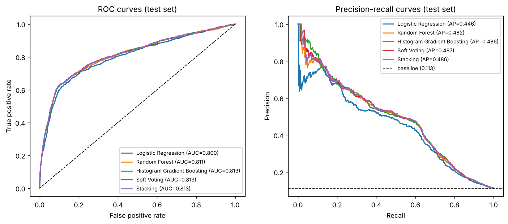

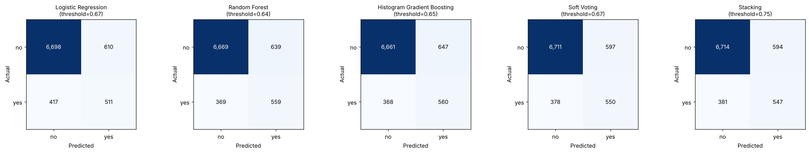

**Effect of the threshold.** At 0.5, class-weighted models over-predict "yes": soft voting flags 1,540 clients (precision 0.39, recall 0.65). At the out-of-fold threshold of 0.67 it flags 1,147 (precision 0.48, recall 0.59), raising F1 from 0.487 to 0.530 and MCC from 0.421 to 0.467, which confirms the Part D strategy.

**Paired comparisons.** The paired bootstrap gives the following differences in test PR-AUC:

| Comparison | Mean difference | 95% CI | Interpretation |
|---|---|---|---|
| Soft voting − Random Forest | +0.005 | +0.001 to +0.009 | small but reliable gain over the pre-selected best model |
| Stacking − Random Forest | +0.004 | +0.001 to +0.007 | small but reliable gain |
| Soft voting − Gradient Boosting | +0.001 | −0.004 to +0.005 | no detectable difference |
| Stacking − Gradient Boosting | −0.000 | −0.006 to +0.006 | no detectable difference |
| Soft voting − Logistic Regression | +0.041 | +0.029 to +0.053 | clear gain |

## H3. Interpretation

1. **Non-linear models are clearly better than the linear baseline.** Every tree-based model beats Logistic Regression by about 0.04 PR-AUC and 0.012 ROC-AUC, and the difference is well outside the bootstrap noise.
2. **The ensembles deliver a small, consistent benefit.** Both beat the cross-validated best model (Random Forest) with intervals excluding zero, and soft voting has the best PR-AUC, ROC-AUC, F1, precision and MCC. The gain over gradient boosting alone is too small to detect. The main benefit is **robustness**: cross-validation could not separate RF from HGB (0.463 vs 0.462), and on the test set they swapped places; averaging removes the need to bet on one.
3. **Stacking adds cost without benefit.** It matched soft voting on ranking, but its meta-learner shifted the probabilities (higher Brier score, threshold 0.75) and it took five to six times longer to train. With only two highly correlated members there is little for a meta-learner to learn beyond an average.
4. **Overall performance is moderate, and that is realistic.** A ROC-AUC of about 0.81 without `duration` matches published pre-call results on this dataset. The leaky benchmark showed 0.945, which is what an inflated study would report.

## H4. What drives the predictions?

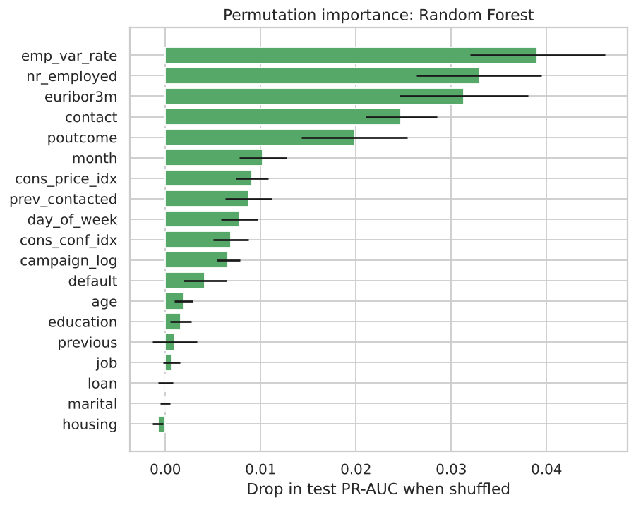

Permutation importance on the test set (the drop in PR-AUC when a feature is randomly shuffled) shows that the **macroeconomic context** dominates: `emp.var.rate`, `nr.employed` and `euribor3m` are the top three. They are followed by **contact channel** (mobile phone contacts convert far better than landline), **previous campaign outcome**, **month**, and the **previous-contact flag**. Personal attributes such as job, education, housing and personal loans add relatively little. For the bank this means the strongest levers are *when* it campaigns and *whom it has successfully contacted before*, more than demographic targeting.

## H5. Business impact

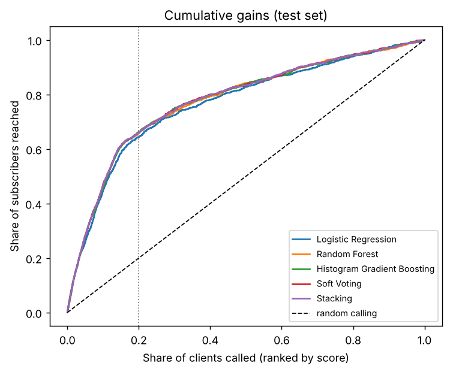

| Clients called (ranked by soft-voting score) | Subscribers reached | Share of all subscribers | Lift | Calls per subscriber |
|---|---|---|---|---|
| Top 10% (824) | 438 | 47.2% | 4.7 | 1.9 |
| Top 20% (1,648) | 613 | 66.1% | 3.3 | 2.7 |
| Top 30% (2,471) | 690 | 74.4% | 2.5 | 3.6 |
| Top 50% (4,118) | 777 | 83.7% | 1.7 | 5.3 |
| Everyone (8,236) | 928 | 100% | 1.0 | 8.9 |

Calling everyone needs about 8.9 calls per subscriber. Calling only the top-scored 20% of clients reaches two-thirds of all subscribers at 2.7 calls each, a reduction of roughly 70% in calls per acquisition. The right cut-off depends on the margin earned from a deposit relative to the cost of a call. The model gives the bank a dial rather than a single answer.

## H6. Recommendation

We recommend the **soft-voting ensemble of Random Forest and Histogram Gradient Boosting**, deployed as a ranking score with a business-chosen cut-off, for the following reasons:

* Best or joint-best on every test metric (PR-AUC 0.487, ROC-AUC 0.813, F1 0.530, MCC 0.467), with a reliable advantage over the cross-validated best single model.
* It removes the risk of picking the wrong tree model.
* It is cheap (about three seconds to train); stacking adds six times the cost for no gain.

If the bank prefers one model for simplicity of maintenance, **Histogram Gradient Boosting alone** is an acceptable fallback, with no measurable loss of accuracy and the fastest training. **Logistic Regression** should be retained as an explanatory companion model for stakeholders and regulators.

**Conditions and limitations.**

* **Economic drift.** The model leans on 2008 to 2010 macro conditions; validate it on recent campaigns, retrain when rates move outside the training range, and test a time-based split as the next experiment.
* **Calibration.** Class weighting inflates probabilities (Brier 0.150 against about 0.08 for an unweighted model). Use the scores for ranking, or recalibrate with isotonic or Platt scaling before reading them as true probabilities.
* **Fairness and privacy.** Age, marital status and job influence scores. The bank should review whether any targeting based on them is acceptable under its policies and data-protection law.
* **Monitoring.** Track subscription rates by score decile and re-fit thresholds quarterly.

# Conclusion

Each of the client's open questions was answered with experimental evidence. The problem is **supervised binary classification** (unsupervised clusters had ARI ≤ 0.10 with the outcome). The right preprocessing keeps 'unknown' as information, removes duplicates and the leaky `duration`, one-hot encodes with rare-level grouping, scales and log-transforms skewed counts, filters collinear features for the linear model only, and uses class weights with a tuned threshold; PCA, SMOTE and undersampling reduced performance. The two tree models clearly beat Logistic Regression, and ensembling them gave a **small but reliable improvement**, mainly robustness to which tree model is best. The recommended soft-voting ensemble lets the bank reach two-thirds of subscribers by calling one-fifth of its clients.

# References

Bergstra, J. and Bengio, Y. (2012) 'Random search for hyper-parameter optimization', *Journal of Machine Learning Research*, 13, pp. 281–305.

Breiman, L. (2001) 'Random forests', *Machine Learning*, 45(1), pp. 5–32.

Chawla, N.V., Bowyer, K.W., Hall, L.O. and Kegelmeyer, W.P. (2002) 'SMOTE: synthetic minority over-sampling technique', *Journal of Artificial Intelligence Research*, 16, pp. 321–357.

Efron, B. and Tibshirani, R.J. (1993) *An Introduction to the Bootstrap*. New York: Chapman & Hall.

Elor, Y. and Averbuch-Elor, H. (2022) 'To SMOTE, or not to SMOTE?', *arXiv preprint* arXiv:2201.08528.

Friedman, J.H. (2001) 'Greedy function approximation: a gradient boosting machine', *Annals of Statistics*, 29(5), pp. 1189–1232.

Hastie, T., Tibshirani, R. and Friedman, J. (2009) *The Elements of Statistical Learning*. 2nd edn. New York: Springer.

Kaufman, S., Rosset, S., Perlich, C. and Stitelman, O. (2012) 'Leakage in data mining: formulation, detection, and avoidance', *ACM Transactions on Knowledge Discovery from Data*, 6(4), pp. 1–21.

Ke, G. et al. (2017) 'LightGBM: a highly efficient gradient boosting decision tree', *Advances in Neural Information Processing Systems*, 30.

Lemaître, G., Nogueira, F. and Aridas, C.K. (2017) 'Imbalanced-learn: a Python toolbox to tackle the curse of imbalanced datasets in machine learning', *Journal of Machine Learning Research*, 18(17), pp. 1–5.

Moro, S., Cortez, P. and Rita, P. (2014) 'A data-driven approach to predict the success of bank telemarketing', *Decision Support Systems*, 62, pp. 22–31. Dataset: UCI Machine Learning Repository, Bank Marketing, doi:10.24432/C5K306.

Pedregosa, F. et al. (2011) 'Scikit-learn: machine learning in Python', *Journal of Machine Learning Research*, 12, pp. 2825–2830.

Rubin, D.B. (1976) 'Inference and missing data', *Biometrika*, 63(3), pp. 581–592.

Saito, T. and Rehmsmeier, M. (2015) 'The precision-recall plot is more informative than the ROC plot when evaluating binary classifiers on imbalanced datasets', *PLoS ONE*, 10(3), e0118432.

van den Goorbergh, R., van Smeden, M., Timmerman, D. and Van Calster, B. (2022) 'The harm of class imbalance corrections for risk prediction models', *Journal of the American Medical Informatics Association*, 29(9), pp. 1525–1534.

Wolpert, D.H. (1992) 'Stacked generalization', *Neural Networks*, 5(2), pp. 241–259.

# Appendix: reproducibility

All code is in `src/`, the full experimental record is `notebooks/bank_marketing_end_to_end.ipynb`, and `python -m src.train` reproduces the models and test results. Random seed 42; scikit-learn 1.9.1, imbalanced-learn 0.14.2, pandas 3.0.5. Tables in this report were generated from `results/*.csv`.

